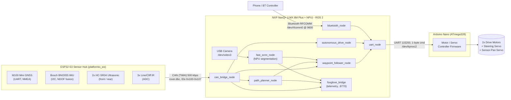
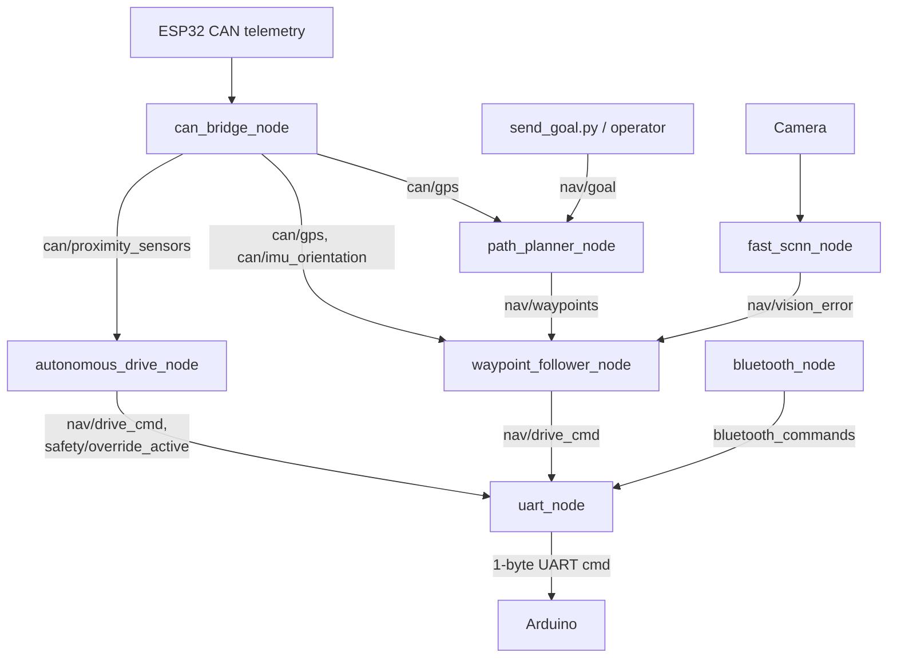

# Senior Design: Autonomous Service Robot

An autonomous ground rover that navigates the UC Riverside campus walkway network using GPS waypoint following fused with real-time camera-based path segmentation, with reactive ultrasonic/cliff obstacle avoidance and a Bluetooth manual-override path. The system is split across three compute/control tiers — an NXP NavQ+ running ROS 2 and an on-chip NPU for vision, an ESP32-S3 sensor hub talking CAN, and an ATmega328 (Arduino Nano) motor/servo controller — bridged by CAN and UART.

## Table of Contents

1. [Overview](#1-overview)
2. [Demo](#2-demo)
3. [System Architecture](#3-system-architecture)
4. [Hardware](#4-hardware)
5. [Software](#5-software)
6. [Navigation Pipeline](#6-navigation-pipeline)
7. [Embedded Control](#7-embedded-control)
8. [Computer Vision](#8-computer-vision)
9. [Safety / Fail-Safes](#9-safety--fail-safes)
10. [Engineering Challenges](#10-engineering-challenges)
11. [Results](#11-results)
12. [Repository Structure](#12-repository-structure)
13. [Future Work](#13-future-work)

---

## 1. Overview

This project is a differential/Ackermann-style ground rover designed to autonomously drive between GPS waypoints along real campus walkways, while a lightweight semantic-segmentation model keeps it centered on the drivable path and a reactive safety layer stops or steers it away from walls, obstacles, and cliff-edges (curbs, stairs, drop-offs).

At a high level, the rover:

1. Is given a destination latitude/longitude.
2. Plans a route over a pre-mapped graph of UC Riverside's walkways (`UCR_Centerlines.json`) using Dijkstra's algorithm, preferring paths tagged as pedestrian walkways.
3. Drives the route by fusing GPS bearing-to-waypoint with an IMU compass heading, correcting laterally using a camera-based drivable-path detector when GPS heading error is small.
4. Continuously watches ultrasonic and line/cliff sensors and interrupts autonomous driving with a scripted escape maneuver (reverse, scan, turn) whenever a wall or drop-off is detected.
5. Can be taken over at any time by a human operator over Bluetooth, which locks out the autonomous drive commands until control is explicitly handed back.

The system was built incrementally: CAN bus sensor telemetry and low-level motor control first, then GPS/waypoint routing, then computer-vision path centering, and finally sensor fusion and safety-state-machine integration (see [Engineering Challenges](#10-engineering-challenges) and the git history for the order these landed in).

## 2. Demo

[](https://youtu.be/J7jprQ1VzI8)

▶️ **[Watch the demo on YouTube](https://youtu.be/J7jprQ1VzI8)**

Here's what's happening in that run, end-to-end:

- An operator (or `send_goal.py`) publishes a target latitude/longitude.
- `path_planner_node` snaps the rover's current GPS fix and the goal onto the nearest walkway graph nodes, runs Dijkstra, and publishes a downsampled waypoint list.
- The rover drives itself along the route, visibly correcting heading at each waypoint and drifting toward the center of the segmented "safe path" region in front of it.
- If it approaches a wall or the ground drops away in front of it, it stops, backs up, scans both directions with the front ultrasonic sensor, and picks whichever side is clearer before resuming.
- The whole run can be watched live over [Foxglove Studio](https://foxglove.dev/) via the `foxglove_bridge` node (WebSocket on port `8770`), which exposes the GPS track, planned path, and the live segmentation overlay.
- A phone or BT controller can send a command at any time to immediately take manual control.

## 3. System Architecture

The rover is split into three physically separate controllers connected by CAN and UART, plus a Bluetooth link for manual control:



Two important architectural notes:

- **The CAN bus is one-way telemetry only.** The ESP32 is a pure CAN *producer* (GPS/IMU/proximity data out); nothing in the firmware calls `twai_receive`. Drive commands never travel over CAN — they go from the NavQPlus directly to the Arduino over a separate UART link.
- **The Arduino is not yet on the CAN bus.** It's a standalone UART-command actuator. Unifying it onto the CAN network (or replacing the UART link with CAN) is a natural next step — see [Future Work](#13-future-work).

## 4. Hardware

| Subsystem | Component | Interface | Notes |
|---|---|---|---|
| **Compute** | NXP NavQ+ (i.MX 8M Plus) | — | Runs Ubuntu + ROS 2, integrated NPU (Verisilicon VX) used for CV inference |
| Camera | USB/V4L2 camera | `/dev/video3`, YUYV, 640×480 | Feeds the segmentation node directly (not a ROS image topic) |
| CAN transceiver | — | `can1` (SocketCAN), 500 kbps | Receives ESP32 sensor telemetry |
| Serial to Arduino | — | `/dev/ttymxc2`, 115200 8N1 | Carries single-byte drive commands |
| Bluetooth | — | `/dev/rfcomm0`, 9600 baud | Manual remote-control input |
| **Sensor Hub** | ESP32-S3 (DevKitC-1) | — | ESP-IDF/FreeRTOS firmware, dual-core task split |
| GPS | M100 Mini GNSS module | UART1, GPIO 11/12, 115200 | NMEA (`$GNGGA`/`$GNVTG`), UBX-configured to disable unused sentences |
| IMU | Bosch BNO055 (9-DOF) | I2C0, GPIO 20/21 @ 100 kHz, addr `0x28` | NDOF sensor-fusion mode; calibration offsets persisted to NVS flash |
| Front/rear ranging | 2× HC-SR04 ultrasonic | Front: trig GPIO15/echo GPIO6; Rear: trig GPIO16/echo GPIO7 | 3-sample averaging, 2–400 cm valid range |
| Cliff/line sensing | 3× analog IR line sensors | ADC1 channels 7/8/9, 12-bit | Center channel also derives a coarse "cliff distance" proxy |
| CAN controller | ESP32-S3 native TWAI | GPIO1 (TX) / GPIO2 (RX), 500 kbps | Accept-all filter, 3x retry on transmit |
| **Actuation** | Arduino Nano (ATmega328 @ 16 MHz) | — | Bare-metal AVR-register firmware (no Arduino API calls) |
| Drive motors | 2× DC motors via H-bridge (TB6612FNG-style) | Motor A: `PD2/PD4` dir, `PD3` PWM (Timer2); Motor B: `PD6/PD7` dir, `PD5` PWM (Timer0) | Both motors driven in tandem for forward/reverse — propulsion only |
| Steering | 1× hobby servo | `PB1` (Timer1 `OC1A`) | Ackermann-style front steering, not skid-steer |
| Sensor pan | 1× hobby servo | `PB2` (Timer1 `OC1B`) | Slaved opposite to steering direction, to look into the turn |
| Command link | UART from NavQPlus | 115200 8N1, RX-interrupt driven | Single-byte command protocol, see [§7](#7-embedded-control) |

## 5. Software

The autonomous stack is a single ROS 2 (`rclpy`) package, **`rover_project`**, built with `ament_cmake` (for custom message generation) and installed under `NavQPlus/ros2_ws/`.

### Nodes

| Node | Role |
|---|---|
| `can_bridge_node.py` | Decodes CAN frames from the ESP32 (via `rover.dbc`/`cantools`) into typed ROS topics — the root of the sensor pipeline |
| `path_planner_node.py` | Builds a routable graph from campus walkway GeoJSON, runs Dijkstra, publishes waypoints, and watches for path deviation |
| `waypoint_follower_node.py` | Fuses GPS bearing + IMU heading + vision path-centering error into a discrete drive command |
| `autonomous_drive_node.py` | Reactive safety state machine — cliff/wall detection and escape maneuvers, can override the waypoint follower |
| `fast_scnn_node.py` | Runs an INT8 Fast-SCNN segmentation model on the NPU to find the drivable path in the camera feed |
| `uart_node.py` | Arbitrates MANUAL vs. AI drive commands and writes the final byte to the Arduino over UART |
| `bluetooth_node.py` | Reads manual drive commands from a paired Bluetooth controller/phone |
| `send_goal.py` | One-shot CLI/launch utility that publishes a navigation goal |
| `insepct_shapefile.py` *(dev utility, not installed)* | Standalone script for exploring the source `.shp` campus map before/after GeoJSON conversion |

### Custom messages (`msg/`)

| Message | Fields |
|---|---|
| `GpsFix` | `latitude`, `longitude`, `speed`, `course`, `fix_type` (0–5, incl. RTK), `num_sats`, `hdop`, `h_acc`, `v_acc` |
| `ImuOrientation` | `heading`, `pitch`, `roll`, `cal_sys`, `cal_mag` |
| `Proximity` | `proximity_front`, `proximity_rear`, `proximity_cliff`, `cliff_detected`, `front_valid`, `rear_valid`, `cliff_valid` |
| `NavGoal` | `latitude`, `longitude` |
| `WaypointList` | `latitudes[]`, `longitudes[]`, `total_waypoints`, `current_index` |

### Launch graph (`launch/rover_launch.py`)

Starts, in order: `can_bridge` → `uart_processor` → `fast_scnn_node` → `path_planner` (walk-paths-only mode) → `autonomous_drive` → `waypoint_follower` → a 5-second-delayed `goal_sender` (hardcoded to a UCR campus coordinate, `33.97400, -117.32800`, to exercise the pipeline without an operator) → `foxglove_bridge` for telemetry.

**Known issue:** several parameters passed in the launch file (`snap_tolerance_ft`, `max_snap_distance_ft`, `vision_assist_max_heading_err_deg`, `min_fix_type`, `obstacle_stop_mm`) don't match any `declare_parameter()` call in the corresponding node — leftover from a feet→meters refactor. They're silently ignored by `rclpy` today; reconciling them is tracked in [Future Work](#13-future-work).

### Build & run

```bash
colcon build --packages-select rover_project
source install/setup.bash
ros2 launch rover_project rover_launch.py
```

## 6. Navigation Pipeline



### Path planning (`path_planner_node.py`)

- Loads `UCR_Centerlines.json`, a GeoJSON `FeatureCollection` of **766 line-segment features**, of which **187 are tagged `Walk_Path=Yes`** (pedestrian walkways vs. roads). `walk_paths_only=True` builds a graph from just the walkway subset, with the full 766-segment network kept as a fallback if walk-only routing can't find a connected path.
- Builds a graph by snapping segment endpoints to 6 decimal places (merging nearby intersections into shared nodes), weighting edges by Haversine great-circle distance, and running a standard heap-based **Dijkstra** between the snapped start/goal nodes.
- Downsamples the resulting path to ~10 m waypoint spacing (`waypoint_spacing_m`), always keeping the first and last points.
- Runs a 2-second deviation watchdog: if the rover's live GPS position drifts more than `replan_deviation_m` (default 5 m) from every segment of the current path, and a `replan_cooldown_s` (default 20 s) has elapsed, it silently replans.
- Rejects GPS fixes with `h_acc` above `max_h_acc_m` (default 10 m) or `fix_type < 2`, and requires a fix within `gps_timeout_s` (default 5 s) before planning at all.

### Waypoint following & sensor fusion (`waypoint_follower_node.py`)

Runs on a timer at `command_rate_hz` (default 5 Hz) and outputs one of 9 discrete drive commands (this is a command-based platform, not continuous velocity/PID):

```
CMD_STOP=2, FORWARD_STRAIGHT=3, FORWARD_RIGHT=4, FORWARD_LEFT=5,
BACKWARD_STRAIGHT=6, BACKWARD_RIGHT=7, BACKWARD_LEFT=8, RIGHT=9, LEFT=10
```

For the current target waypoint, bearing is computed with the standard initial-bearing formula and compared to a corrected IMU heading (`raw_heading + heading_offset_deg + magnetic_decline_deg`):

```python
def bearing(lat1, lon1, lat2, lon2):
    p1, p2 = math.radians(lat1), math.radians(lat2)
    dl = math.radians(lon2 - lon1)
    x = math.sin(dl) * math.cos(p2)
    y = math.cos(p1)*math.sin(p2) - math.sin(p1)*math.cos(p2)*math.cos(dl)
    return math.degrees(math.atan2(x, y)) % 360.0
```

**GPS/vision arbitration** — GPS is authoritative unless the heading error is small *and* vision data is fresh, in which case the finer-grained vision correction takes over for lane centering:

```python
vision_is_fresh = (now - self.last_vision_time) < 1.0
if abs(gps_err) > self.gps_takeover_deg or not vision_is_fresh:
    nav_source = "GPS"      # straight / hard-turn / hysteresis-gated soft turn on bearing error
else:
    nav_source = "VISION"   # straight / hard-turn / soft turn on segmentation pixel offset
```

A turn-direction hysteresis band (`heading_tolerance_deg + heading_hysteresis_deg`) prevents command chatter near the straight/turn boundary, and an off-course watchdog logs an "OFF COURSE ALARM" if distance-to-waypoint grows for `progress_check_interval_sec` instead of shrinking (currently log-only — auto-stop is written but commented out).

An `invert_drive` flag remaps FORWARD↔BACKWARD in `send_cmd()` to compensate for reversed physical wiring, and the same command table/inversion scheme is shared by `autonomous_drive_node.py`.

## 7. Embedded Control

### ESP32-S3 sensor hub (`ESP32/platformio_ws`)

ESP-IDF/FreeRTOS firmware split across three tasks pinned to specific cores so the GPS UART parser isn't starved by the ultrasonic sensors' busy-wait timing loops:

| Task | Core | Priority | Rate | Sensor |
|---|---|---|---|---|
| `bno055_read_task` | 0 | 5 | 20 ms (50 Hz) | BNO055 accel / gyro / Euler / quaternion |
| `gnss_uart_task` | 1 | 10 (highest) | NMEA-driven, throttled to 1 Hz CAN publish | M100 Mini GNSS |
| `proximity_sensors_task` | 0 | 7 | 50 ms (20 Hz) | 2× HC-SR04 + 3× line/cliff IR |

- **GPS**: hand-written NMEA parser (`$GNGGA` for position/fix/HDOP, `$GNVTG` for speed/course) with XOR checksum verification; a `$GNGGA` sentence is what triggers a CAN publish. Fix quality (`INVALID`→`COARSE`→`GOOD`→`EXCELLENT`→`RTK`) is derived from NMEA fix-quality bits and HDOP.
- **IMU**: BNO055 run in `NDOF` (9-DOF sensor fusion) mode. Once all four calibration sub-systems (system/gyro/accel/mag) reach status 3, the firmware automatically saves the 22-byte calibration offset block to NVS flash and reloads it on the next boot — so the IMU doesn't need to be recalibrated from scratch every power-cycle.
- **Ultrasonic**: HC-SR04 pulses are averaged over 3 samples and range-filtered to the sensor's valid 2–400 cm window.
- **Cliff detection**: any of the 3 line/IR sensors reading below an ADC threshold (`< 100` of 4095) is treated as "lifted/over an edge" — deliberately conservative (OR, not AND) to catch partial edge cases.
- **CAN transmit**: native TWAI driver at 500 kbps (GPIO1 TX / GPIO2 RX), accept-all filter, up to 3 retries per frame with a 100 ms timeout. The ESP32 never calls `twai_receive` — it is a pure telemetry producer.

**CAN protocol (`rover.dbc`)** — 8 standard 8-byte frames, `ESP32` → `NavQPlus`:

| ID | Message | Key signals | Cycle |
|---|---|---|---|
| `0x100` | `GPS_Position` | lat/lon, int32 @ 1e-7° | 100 ms |
| `0x101` | `GPS_Velocity` | speed, course, fix type, sat count, HDOP | 100 ms |
| `0x102` | `GPS_Accuracy` | horizontal/vertical accuracy (m) | 100 ms |
| `0x103` | `IMU_Accel` | X/Y/Z accel + calibration status | 20 ms |
| `0x104` | `IMU_Gyro` | X/Y/Z gyro + calibration status | 20 ms |
| `0x105` | `IMU_Orientation` | heading/pitch/roll + calibration | 50 ms |
| `0x106` | `IMU_Quaternion` | W/X/Y/Z | 50 ms |
| `0x107` | `Proximity_Sensors` | front/rear/cliff distance (mm), validity + cliff flags | 50 ms |

> Note: the DBC declares 100 ms GPS cycle times, but the firmware actually throttles GPS CAN publishes to **1 Hz** to decouple them from the NMEA sentence rate — the DBC reflects the intended, not the current, cadence.

### Arduino motor/servo controller (`Arduino/src/main.cpp`)

Bare-metal AVR-register firmware (ATmega328 @ 16 MHz) — no Arduino API calls despite the `framework = arduino` PlatformIO setting. Entirely interrupt-driven: `main()` just calls `init_all()` and spins.

- **Command protocol**: single UART byte, 0–10, received via `ISR(USART_RX_vect)`:
  ```
  OFF=0, AI=1, STOP=2,
  FORWARD_STRAIGHT=3, FORWARD_RIGHT=4, FORWARD_LEFT=5,
  REVERSE_STRAIGHT=6, REVERSE_RIGHT=7, REVERSE_LEFT=8,
  RIGHT=9, LEFT=10
  ```
  This is the **authoritative** drive command table for the whole system — it matches `waypoint_follower_node.py`/`autonomous_drive_node.py`, not the (unused, mismatched) local constants in `uart_node.py`, since `uart_node.py` forwards command bytes verbatim without remapping.
- **Drivetrain**: propulsion is two DC motors driven in tandem (not independently — this is Ackermann steering, not skid-steer), plus one steering servo for the front wheels and one "pan" servo that points a forward sensor into the direction of the turn.
- **Timers**: Timer0/Timer2 run 8-bit Fast-PWM for motor speed; Timer1 runs 16-bit Fast-PWM (mode 14, `ICR1`-as-TOP) for both servos.
- **Safety watchdog**: `ISR(TIMER1_OVF_vect)` fires at the ~50 Hz servo PWM rate and counts ticks since the last valid command byte. After `SAFETY_TIMEOUT` (50 ticks ≈ **1 second of UART silence**), it force-stops all motors — this is the last line of defense if the NavQPlus link drops.

## 8. Computer Vision

`fast_scnn_node.py` runs a **quantized INT8 Fast-SCNN** semantic-segmentation model (`NavQPlus/models/fast_scnn_opt_int8.tflite`, ~123 KB) directly against a live USB camera feed, on the NavQPlus's integrated NPU:

- The TFLite interpreter is loaded with the Verisilicon **VX NPU delegate** (`libvx_delegate.so`) first, falling back to CPU-only inference if the delegate fails to load.
- Frames are captured at 640×480 YUYV, resized to 512×512 RGB `uint8` for inference, buffer size 1 with 2 discarded grabs per cycle to flush stale V4L2 frames — running at 10 Hz.
- The output mask is classified into 7 classes: safe path, soft terrain, vegetation, static obstacle, dynamic obstacle, sky, and unlabeled.

**Path-center extraction** — rather than a full navigable-area analysis, the node scans a single row at 75% of image height, marks pixels belonging to any "habitable" class (safe path / soft terrain / vegetation), and finds the **largest contiguous run** of such pixels (tolerating small gaps up to 10 px, ignoring obstacles narrower than ~4% of the frame width):

```python
is_habitable = (mask == 1) | (mask == 2) | (mask == 3)
path_pixels = np.where(is_habitable[search_row_idx, :])[0]
step = np.diff(path_pixels)
splits = np.where(step > GAP_TOLERANCE)[0] + 1
chunks = np.split(path_pixels, splits)
largest_chunk = max(chunks, key=len)
path_center_x = int(np.median(largest_chunk) * (CAM_WIDTH / mask_w))
error = float(path_center_x - (CAM_WIDTH // 2))
```

The resulting pixel offset (`nav/vision_error`) is what `waypoint_follower_node.py` uses for fine lateral centering, but **only** when it's fresh (<1 s old) and the GPS heading error is already small — vision is a corrective refinement layer on top of GPS routing, not a standalone navigator. If no habitable pixels are found on the scan row, the node emits a sentinel `9999.0` to signal "blind," which pushes the fusion logic back toward GPS. An optional visualization overlay (color-mapped mask + path-center marker) can be enabled for debugging/Foxglove display without impacting the default (disabled) CPU budget.

## 9. Safety / Fail-Safes

Multiple independent layers, from the physical actuator up to the planner:

1. **UART comms watchdog (Arduino)** — force-stops all motors after ~1 second without a valid command byte from the NavQPlus. This is the hardware-level backstop if the whole ROS stack crashes or the serial link drops.
2. **Cliff detection latch (`autonomous_drive_node.py`)** — an ESP32 line-sensor cliff flag immediately raises `safety/override_active`, sends `STOP`, and holds the stop for a debounce window (`cliff_hold_s`) after the last cliff reading, before handing off to the escape sequence below.
3. **Wall/obstacle avoidance state machine** — requires several consecutive valid ultrasonic readings below a threshold (hysteresis against false positives) before triggering a scripted escape: reverse → check rear clearance → turn and sample left → turn and sample right → drive out through whichever side reads clear → resume forward waypoint following.
4. **Override interlock** — while `autonomous_drive_node.py` holds `safety/override_active`, `waypoint_follower_node.py` stays silent entirely (does not publish drive commands), so there's no possibility of the two competing for the bus.
5. **Manual override lockout (`uart_node.py`)** — any Bluetooth command other than the explicit "resume AI" sentinel switches the rover into MANUAL mode and drops all further autonomous `nav/drive_cmd` messages until the operator explicitly hands control back.
6. **CAN transmit retries (ESP32)** — up to 3 retries per frame with bus-state checks, so transient bus contention doesn't silently drop sensor telemetry.
7. **GPS quality gating** — the path planner refuses to plan (and the waypoint follower won't trust GPS) below a minimum fix type or above a maximum horizontal-accuracy threshold, reducing the chance of navigating on a bad fix.

**Known gap:** `uart_node.py` contains a `failsafe_check()` intended to auto-stop the rover after 3 seconds of ROS-side command silence, but it is not currently wired to a ROS timer in `__init__()` — it exists but never runs. The Arduino-side 1-second UART watchdog (#1 above) still protects against a fully dead link, but this ROS-level check should be reconnected; see [Future Work](#13-future-work).

## 10. Engineering Challenges

- **Heading correction** — raw IMU compass heading needed both a fixed mounting offset and a magnetic-declination correction before it was usable for bearing comparisons; getting this wrong showed up as a persistent steady-state turn bias (see the "Fixed Corrected Heading Issue" commit).
- **GPS/vision arbitration tuning** — deciding *when* to trust the segmentation model's pixel-offset correction over GPS bearing (and vice versa) required iterating on heading-error thresholds and a freshness timeout so the rover didn't fight itself between two disagreeing corrections near intersections and open areas.
- **Migrating from shapefile to GeoJSON routing** — the campus walkway data started as a `.shp`/`.dbf`/`.shx` shapefile (explored with the standalone `insepct_shapefile.py` utility) and was converted to a single GeoJSON graph to avoid a `geopandas`/`shapely` runtime dependency on the embedded compute module, at the cost of maintaining a conversion step whenever the source map changes.
- **NPU deployment of the segmentation model** — quantizing Fast-SCNN to INT8 and getting the Verisilicon VX delegate to actually accelerate inference (with a correctness-preserving CPU fallback) rather than silently falling back on every run.
- **Real-time CPU budget on the compute module** — the ESP32↔NavQPlus data path and the segmentation loop both compete for CPU/bus time on modest embedded hardware; several passes went into reducing parsing overhead and CAN polling cost (see the "new data parsing, better CPU usage" commit).
- **Hybrid CAN + UART architecture** — the sensor bus (CAN, ESP32→NavQPlus) and the actuation bus (UART, NavQPlus→Arduino) are two separate, asymmetric links rather than one unified network, which works but has produced integration friction (e.g. a front/rear ultrasonic channel swap that had to be compensated for in `can_bridge_node.py` rather than fixed at the source).
- **Keeping launch-time configuration in sync with node code** — several parameters evolved (e.g. feet→meters unit changes) without their launch-file counterparts being updated, leaving a few silently-ignored launch arguments that need reconciling.

## 11. Results

The system currently demonstrates, end-to-end on the UC Riverside campus walkway network:

- GPS-goal-to-route planning over real mapped walkway data (Dijkstra over a 187-segment pedestrian-path graph, with a 766-segment full-network fallback).
- Autonomous waypoint following with GPS+IMU bearing control, refined by camera-based path centering when heading error is small.
- Reactive obstacle and cliff avoidance that can interrupt and resume autonomous driving without operator intervention.
- Live Bluetooth manual override that cleanly takes over from and hands back to the autonomous stack.
- Live remote telemetry (GPS track, planned path, segmentation overlay) via Foxglove Studio.

Formal quantitative benchmarks (waypoint-tracking error, obstacle-avoidance success rate, end-to-end run video) have not yet been captured in this repository — see [Demo](#2-demo) and [Future Work](#13-future-work).

## 12. Repository Structure

```
Senior-Design/
├── Arduino/                        # ATmega328 (Nano) low-level motor/servo firmware
│   ├── src/main.cpp                #   active bare-metal AVR firmware
│   ├── include/timerISR.h          #   unused course-lab timer helper (dead code)
│   ├── lib/test.cpp                #   standalone servo bring-up test
│   ├── test/test.cpp               #   standalone UART/LED bring-up test
│   └── platformio.ini
├── ESP32/
│   ├── platformio_ws/               # ESP32-S3 sensor hub firmware (active)
│   │   ├── src/{main,can,gps,imu,rover,ultrasonic}.c
│   │   ├── include/{can,gps,imu,rover,ultrasonic}.h   # rover.h/.c are cantools-generated DBC bindings
│   │   └── platformio.ini
│   └── can_comm/                    # scaffolded ESP-IDF project, no source yet (WIP)
├── NavQPlus/                        # NXP NavQ+ compute module — ROS 2 + CV
│   ├── models/fast_scnn_opt_int8.tflite
│   ├── rover.dbc                    # CAN message database (ESP32 -> NavQPlus)
│   ├── test_can_receive.py          # standalone (non-ROS) CAN bring-up/debug tool
│   └── ros2_ws/rover_project/
│       ├── scripts/                 # the 8 ROS2 nodes described in §5
│       ├── msg/                     # 5 custom message definitions
│       ├── launch/rover_launch.py
│       ├── maps/UCR_Centerlines.*   # source shapefile (pre-GeoJSON conversion)
│       ├── UCR_Centerlines.json     # routing graph consumed at runtime
│       └── rover.dbc
└── README.md
```

## 13. Future Work

- **Unify the CAN and UART links.** Migrate the Arduino motor controller onto the CAN bus (or otherwise make the actuation path symmetric with the sensor path) instead of a separate one-way UART command link.
- **Wire up the dead ROS-level failsafe.** Connect `uart_node.py`'s `failsafe_check()` to an actual ROS timer so a stalled ROS graph is caught before it relies solely on the Arduino's 1-second hardware watchdog.
- **Reconcile launch-file parameters with node code.** Several launch arguments (unit-mismatched `_ft` parameters, a few undeclared parameter names) are currently silent no-ops and should be fixed or removed.
- **Closed-loop / continuous control.** Replace the discrete 9-command drive interface with continuous velocity or a PID/pure-pursuit controller for smoother path tracking.
- **RTK GPS.** The CAN/DBC schema already reserves fix types for GNSS+RTK and RTK-float; wiring up an RTK-capable GNSS module would meaningfully tighten waypoint-reached and cross-track accuracy.
- **Expand map coverage** beyond the current UCR walkway subset, and automate the shapefile→GeoJSON conversion pipeline instead of a manual one-off step.
- **Populate or remove the `ESP32/can_comm` scaffold** — it's currently an empty, untracked PlatformIO project with no functional code.
- **Capture demo media and quantitative results** — record a run video/GIF and log waypoint-tracking/obstacle-avoidance metrics for this README (see [§2](#2-demo) and [§11](#11-results)).
